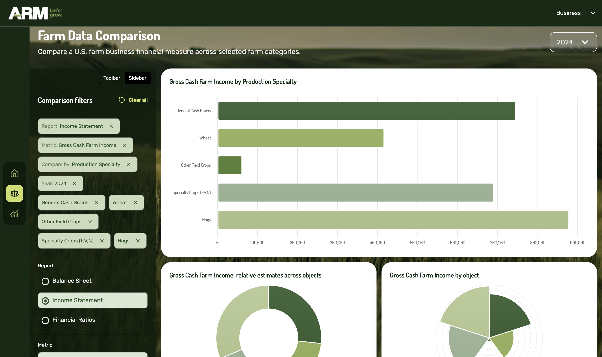
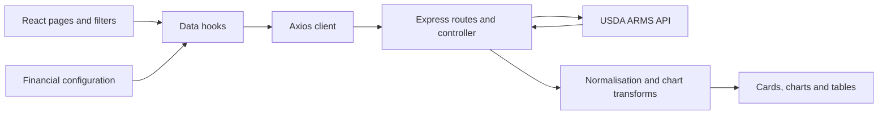
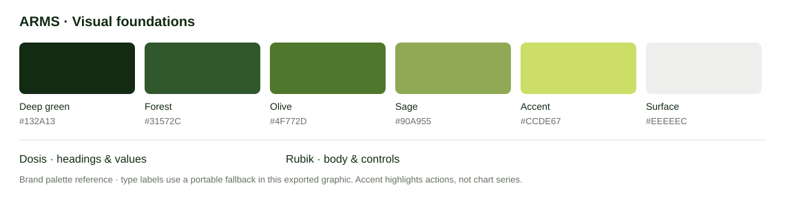

# ARMS Dashboard

**U.S. farm finances, made easier to explore.** A DV200 React project by Kirsten Venter, translating USDA Agricultural Resource Management Survey data into financial summaries, comparisons and trends.


*Development preview, 21 October 2026. Layout and controls continue to evolve.*

## Contents

- [About the Project](#about-the-project)
- [Key Features](#key-features)
- [Tech Stack](#tech-stack)
- [Getting Started](#getting-started)
  - [Prerequisites](#prerequisites)
  - [Installation](#installation)
  - [Configuration](#configuration)
- [Usage](#usage)
- [Project Structure](#project-structure)
- [Architecture](#architecture)
- [Stylekit](#stylekit)
- [Roadmap](#roadmap)
- [Contributing](#contributing)
- [License](#license)
- [Acknowledgments](#acknowledgments)
- [Contact](#contact)

## About the Project

ARMS Dashboard is a read-only exploration tool for U.S. farm business finances. It organises income statements, balance sheets and financial ratios into three complementary views. A small Express backend connects the browser to the USDA API and keeps the API key on the server.

Estimates describe survey groups, not individual farm accounts. Currency measures retain their **dollars per farm** context; ratios and percentages retain their own units. Comparing group estimates does not produce a national total.

## Key Features

- **Overview:** headline KPIs and custom React financial statement and ratio cards.
- **Comparison:** one selected metric across farm groups, using bar, donut and polar area charts, plus expandable table details. Five objects are selected by default; at least two are required.
- **Timeline:** a selectable financial measure over the latest ten available survey years, with a line chart and summary KPIs.
- **Flexible filtering:** toolbar or sidebar layouts, pending changes applied explicitly, and mobile offcanvas controls.
- **API handling:** shared financial configuration, normalised records, request deduplication, server caching and loading/error states.

Farm Business is the implemented domain. Household is reserved for future development. Donut and polar views have limitations for negative values; the app uses alternate handling where applicable.

## Tech Stack

| Purpose | Tools |
| --- | --- |
| Interface | React 19, JavaScript, Vite 8, React Router |
| Components and styling | Bootstrap, React Bootstrap, React Select, Lucide, CSS |
| Visualisation | Chart.js, react-chartjs-2; custom React/CSS Overview components |
| Data access | Axios, Express 5, CORS, dotenv |
| Quality and delivery | ESLint, Git, GitHub Actions / Pages workflow |

## Getting Started

### Prerequisites

Node.js **20.19+ within v20, or 22.12+**, npm, Git and a USDA ARMS API key. The app needs internet access to retrieve survey data; fonts and the background image also load externally.

### Installation

```sh
git clone https://github.com/KIRSTEN-23/arms-dashboard.git
cd arms-dashboard
npm ci --prefix backend
npm ci --prefix frontend
```

### Configuration

Create `backend/.env`:

```dotenv
PORT=5001
ARMS_BASE_URL=https://api.ers.usda.gov/data/arms
ARMS_API_KEY=your_usda_api_key
FRONTEND_URL=http://localhost:5173
```

Create `frontend/.env`:

```dotenv
VITE_API_BASE_URL=http://localhost:5001/api
```

Keep the USDA key in the backend environment; never put it in a `VITE_` variable or commit it.

Start each service in a separate terminal:

```sh
# Terminal 1
npm run dev --prefix backend
```

```sh
# Terminal 2
npm run dev --prefix frontend
```

Open the URL printed by Vite, normally `http://localhost:5173`. If its port changes, update `FRONTEND_URL` accordingly.

```sh
npm run lint --prefix frontend
npm run build --prefix frontend
npm run preview --prefix frontend
```

Preview serves the built frontend; the backend must still run. GitHub Pages also needs a separately hosted HTTPS backend: see [deployment setup](frontend/README.md#github-pages-deployment).

## Usage

1. Start on **Overview** and select a survey year for the national financial snapshot.
2. Open **Comparison**, choose a report, metric, comparison group and objects, then **Apply**. Use table details for supporting statistics.
3. Open **Timeline**, choose a metric and available year range, then **Apply** to explore change over time.

Use the layout switch to try toolbar or sidebar filters. Mobile layouts place filters in an offcanvas panel. Available years and objects come from the API; the latest survey year may precede the calendar year.

## Project Structure

```text
arms-dashboard/
├── backend/
│   ├── server.js              # Environment, CORS and Express entry
│   ├── routes/                # Read-only ARMS endpoints
│   └── controllers/           # USDA requests, caching and errors
├── frontend/src/
│   ├── api/                   # Browser API client
│   ├── data/                  # Reports, metrics, defaults and chart options
│   ├── hooks/                 # Metadata, page data and filter state
│   ├── utils/                 # Normalisation, formatting and transforms
│   ├── components/            # Layout, filters, charts and cards
│   └── pages/                 # Overview, Comparison and Timeline
├── docs/                      # API reference samples and README visuals
└── wireframe iterations/      # PNGs, editable SVGs and optional gallery
```

## Architecture



`farmBusinessMetrics.js` defines report associations, supported metrics, page availability and defaults. Metadata supplies selectable objects. The backend caches successful responses and combines duplicate requests; hooks prepare the returned records for presentation. No application database is used.

## Stylekit



Forest, olive and sage distinguish data series; the yellow-green accent highlights actions. Dosis gives headings a rounded character, while Rubik supports readable controls and body text. Rounded containers, restrained shadows and responsive layouts carry the visual system across pages.

[Planning and design reference](https://www.figma.com/design/ImdhjWYWqjC7x7nbk2xqae/DV200_T1-Planning) · [Wireframe process](wireframe%20iterations/README.md) · [All iteration images](wireframe%20iterations/png)

The visual process contains **13 greyscale reconstructions and three colour studies**. Earlier sheets reconstruct documented plans and experiments; they are not original historical screenshots. Detailed reflection is reserved for the post-project presentation.

## Roadmap

- [ ] Complete Household views and confirm their metric coverage.
- [ ] Verify the custom Overview visualisation against the assessment criteria.
- [ ] Extend API failure, missing-value and negative-value verification.
- [ ] Complete keyboard, contrast and responsive checks across filter layouts.
- [ ] Add the walkthrough video and final presentation; verify hosted deployment.

## Contributing

Open an issue describing the proposed improvement, then submit a focused pull request. Preserve USDA identifiers and units, document configuration changes and run the frontend lint and build checks. An automated backend test suite is not yet configured.

## License

No project-wide license file has been added. Third-party packages and assets retain their respective licenses; a repository license should be selected before broader reuse.

## Acknowledgments

[USDA Economic Research Service](https://www.ers.usda.gov/developer/data-apis/arms-data-api) for the dataset; [Chart.js](https://www.chartjs.org/), [Lucide](https://lucide.dev/), [Google Fonts](https://fonts.google.com/) and [Unsplash](https://unsplash.com/) for supporting resources. The watering-can loader credits Max Prehoda in its source. Research, planning and development were completed for DV200, with AI assistance during exploration and implementation.

## Contact

**Kirsten Venter** · [GitHub profile](https://github.com/KIRSTEN-23) · [Project issues](https://github.com/KIRSTEN-23/arms-dashboard/issues)
